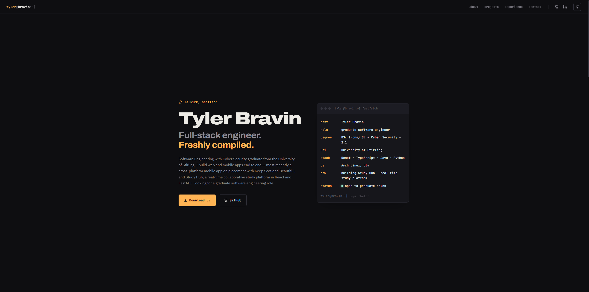

# Personal Portfolio Website


[](https://github.com/tyler-bravin/Portfolio-Website/blob/master/LICENSE)

A personal portfolio website built with **React** and **Vite**, designed around an "engineering workstation" aesthetic — graphite surfaces, an amber terminal accent, and a monospace-led type system (Archivo, IBM Plex Sans, JetBrains Mono). It features a fastfetch-style system readout with a working terminal, a hand-written Study Hub case study, and dynamically fetches project data directly from the GitHub API.

<br>



---

### ✨ Key Features
* **System Readout Hero**: A fastfetch-style terminal panel summarising who I am — a nod to my daily-driver Linux setup.
* **Interactive Terminal**: The readout prompt actually works — try `help`, `whoami`, `cd projects`, `cv`, or `sudo` and see what happens.
* **Featured Case Study**: A hand-written deep dive into Study Hub (built under the ForthByte org), covering the real-time architecture — WebSockets, Redis presence, and JWT refresh queueing.
* **GitHub API Integration**: Recent projects are pulled live from the GitHub API — descriptions, languages, stars — and open into full README modals. Works with or without an auth token.
* **Project Carousel**: Repos display in a scroll-snap carousel — three per view with arrow controls on desktop, native swipe with a peek of the next card on mobile.
* **Dynamic Theme Switching**: Toggle between dark and light themes, with your preference saved in local storage and matching favicons per theme (plus an adaptive SVG favicon that follows the browser's colour scheme).
* **Scrollspy Navigation**: The header highlights whichever section is currently on screen.
* **Smooth Animations**: Utilises **Framer Motion** for subtle, professional animations and transitions on page load and scroll, with `prefers-reduced-motion` respected.
* **Social & SEO Ready**: Open Graph and Twitter card meta with a generated share image, JSON-LD Person schema, and an RFC 9116 `security.txt`.
* **Responsive Design**: The layout adapts seamlessly to a range of devices, from desktops to mobile phones.

---

### 💻 Technologies Used
* **Frontend**: React.js, HTML5, CSS3, JavaScript
* **Build Tooling**: Vite
* **Styling & Theming**: CSS Custom Properties (Variables), Responsive CSS, scroll-snap
* **Animation**: `framer-motion`
* **Icons**: `react-icons`
* **API Integration**: GitHub REST API
* **Other Libraries**: `react-responsive-carousel` for image slideshows

---

### 🛠️ Installation & Setup

Follow these steps to get a local copy of the project up and running.

1.  **Clone the repository:**
    ```bash
    git clone https://github.com/tyler-bravin/Portfolio-Website.git
    cd Portfolio-Website
    ```

2.  **Install dependencies:**
    ```bash
    npm install
    ```

3.  **Set up Environment Variables (optional):**
    The site works without any configuration — GitHub data is fetched unauthenticated. Adding a Personal Access Token raises the API rate limit.

    * Create a file named `.env` in the root of your project.
    * Add your GitHub token to the file in the following format:
        ```env
        VITE_GITHUB_TOKEN=your_personal_access_token_here
        ```
    > **Note:** The token only needs the `public_repo` scope. For security, never share this file or commit it to your repository. You can follow [GitHub's official guide to create a Personal Access Token](https://docs.github.com/en/authentication/keeping-your-account-and-data-secure/managing-your-personal-access-tokens#creating-a-personal-access-token-classic).

4.  **Start the development server:**
    ```bash
    npm run dev
    ```
    The application will now be running on `http://localhost:3000`.

5.  **Build for production:**
    ```bash
    npm run build
    ```
    The optimised output is written to `dist/`, and `npm run preview` serves it locally.

---

### 📜 License
This project is licensed under the MIT License. See the `LICENSE` file for details.
